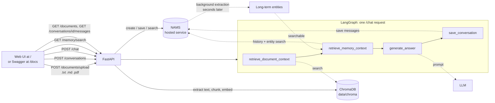

# MemoryRAG

A small, readable project that shows how four pieces fit together:

| Piece | Role here |
|---|---|
| **NAMS** (Neo4j Agent Memory Service) | Stores conversations and turns them into **long-term memory** (entities) in the background |
| **ChromaDB** | Local vector store for your **uploaded documents** (`.txt`, `.md`, `.pdf`; retrieval / RAG) |
| **LangGraph** | A tiny, fixed 4-step **workflow** behind `POST /chat` |
| **FastAPI** | Serves the **web UI** at `/`, the **REST API**, and the Swagger UI at `/docs` |
| **LLM** (OpenAI-compatible) | Writes the final answer from the retrieved context |

It ships with a small **web UI** (open `/`) for demos and presentations. Every feature is also available through the REST API and Swagger UI at `/docs`.

## Architecture



**Two kinds of "memory" - don't mix them up**

- *LangGraph state* lives for one request and is discarded. No checkpointer is used.
- *NAMS memory* is durable. Messages are saved immediately; entities are extracted from them **asynchronously**.

## Project structure

```
MemoryRAG/
├── app/
│   ├── main.py                 # builds the app, serves the UI at "/", health check
│   ├── config.py               # settings from .env
│   ├── models.py               # request/response schemas
│   ├── errors.py               # ConfigError / UpstreamError + safe error translation
│   ├── api/
│   │   ├── documents.py        # upload (.txt/.md/.pdf) and list documents
│   │   ├── conversations.py    # create conversation, chat, messages, extraction status
│   │   └── memory.py           # long-term memory search
│   ├── services/
│   │   ├── nams_service.py     # all NAMS code
│   │   ├── vector_service.py   # chunking, embeddings, ChromaDB
│   │   └── llm_service.py      # prompt + chat model
│   ├── graph/
│   │   ├── state.py            # LangGraph state
│   │   └── workflow.py         # the 4-node chat graph
│   └── static/                 # web UI: index.html, style.css, app.js
├── tests/
├── data/chroma/                # created on first run (ignored by git)
├── .env.example  .gitignore  pytest.ini  requirements.txt  README.md
```

## Read these files first

1. [app/services/nams_service.py](app/services/nams_service.py) - all NAMS code, with the verified SDK calls listed at the top (the main learning target)
2. [app/graph/workflow.py](app/graph/workflow.py) and [app/graph/state.py](app/graph/state.py) - the whole chat flow
3. [app/services/vector_service.py](app/services/vector_service.py) - chunking, embeddings, Chroma
4. [app/services/llm_service.py](app/services/llm_service.py) - the prompt
5. [app/api/](app/api) and [app/main.py](app/main.py) - thin HTTP layer
6. [app/static/](app/static) - the web UI (plain HTML/CSS/JS, no build step; `app.js` is the only logic)

## Prerequisites

- Windows with Python 3.14 (what this was built and tested on; other recent 3.x versions are untested)
- A **NAMS API key** (from the NAMS console)
- An **OpenAI-compatible API key** for chat and embeddings (OpenAI by default; see `LLM_BASE_URL`)

## Setup (Windows PowerShell)

```powershell
cd "D:\MemoryRAG — AI Knowledge Assistant"
python -m venv .venv
.\.venv\Scripts\Activate.ps1          # if blocked: Set-ExecutionPolicy -Scope Process Bypass
pip install -r requirements.txt
Copy-Item .env.example .env
notepad .env                           # fill in the keys
```

Already have the virtual environment from an earlier version? Run `pip install -r requirements.txt` again (PDF support added the `pypdf` package).

## Configuration (`.env`)

Required:

| Variable | Meaning |
|---|---|
| `MEMORY_API_KEY` | Your NAMS key (`nams_...`) |
| `MEMORY_ENDPOINT` | NAMS base URL, default `https://memory.neo4jlabs.com/v1` |
| `LLM_API_KEY` | Key for the chat model |
| `LLM_MODEL` | Chat model name, default `gpt-4o-mini` |
| `EMBEDDING_MODEL` | Embedding model, default `text-embedding-3-small` |

`EMBEDDING_API_KEY` is only needed if it differs from `LLM_API_KEY` (or if you set `LLM_BASE_URL`/`EMBEDDING_BASE_URL`; the chat key is never sent to a different host automatically).
`LLM_PROVIDER` is `openai` (any OpenAI-compatible server works through `LLM_BASE_URL`).
Chunk size, retrieval size, Chroma folder and the rest are optional; see [.env.example](.env.example). `MAX_UPLOAD_MB` (default 10) caps the size of each uploaded file.
Some newer chat models (for example the GPT-5 family) only accept their default sampling settings, so the app sends none. Set `LLM_MODEL` to any model your key can use.

Missing keys never crash startup. The feature that needs them answers with a clear `503` that names the variable.
Secrets are held as `SecretStr` and never logged or returned.

## Run

```powershell
uvicorn app.main:app --reload
```

- **http://127.0.0.1:8000/** - the web UI
- **http://127.0.0.1:8000/docs** - Swagger UI: every endpoint has a "Try it out" button and prefilled examples

## Web UI

Left: conversations (kept in your browser; the memory itself lives in NAMS) and document upload (drag and drop `.txt`, `.md` or `.pdf` files, or click **Load sample document**). Uploaded documents are listed with their chunk counts.
Centre: the chat. Right: **Behind the last answer** shows which documents and memory entities the model was given, whether the messages were saved, and a live badge for NAMS' background extraction
(*Extracting entities in the background...* then *Saved to long-term memory*). Below it you can search long-term memory directly.

The **Demo guide** button walks through the "memory across conversations" experiment with clickable prompts.
Removing a conversation from the list (x) only forgets it in the browser; nothing is deleted from NAMS.
The UI uses no external libraries or CDNs, so it also works offline except for the API calls.

## Endpoints

### `GET /health`
```json
{"status":"ok","chroma":{"status":"ok","chunks_indexed":12},"nams":{"configured":true},"llm":{"configured":true,"provider":"openai","model":"gpt-4o-mini"}}
```
`status` is `degraded` if a key is missing or Chroma fails. No LLM call is made. `GET /health?deep=true` additionally makes **one** cheap authenticated request to NAMS and adds `"reachable": true/false`.

### `POST /documents/upload` (multipart form)
Fields: `file` (`.txt`, `.md` or `.pdf`; default max 10 MB) and optional `document_id`. Text files must be UTF-8. For PDFs the text layer is extracted; scanned/image-only PDFs have none and are rejected with a clear message (they would need OCR), as are password-protected or corrupted PDFs.
```json
{"document_id":"3f0c...","filename":"atlas.md","chunks_indexed":7,"replaced_existing":false}
```
Re-uploading with the **same** `document_id` replaces that document's chunks (no duplicates). Without one, a new id is generated, so uploading the same file twice creates two documents.
Errors: `415` wrong type, `400` empty / not UTF-8 / binary / unreadable PDF, `413` too large, `422` bad `document_id`.

### `POST /conversations`
```json
{"title": "AI Research"}
```
```json
{"conversation_id":"<id generated by NAMS>","title":"AI Research"}
```
NAMS conversations have no title field, so the title is sent as conversation `metadata`.

### `POST /chat`
```json
{"conversation_id": "<id from /conversations>", "message": "Which project am I working on?"}
```
```json
{
  "answer": "From memory: you are working on Project Atlas.",
  "conversation_id": "<id>",
  "document_sources": ["atlas.md"],
  "memory_retrieval_succeeded": true,
  "memory_retrieval_status": "ok",
  "memory_entities_used": [{"name": "Atlas", "type": "OBJECT", "description": "..."}],
  "messages_saved": true,
  "extraction_status": "pending",
  "warnings": []
}
```
(Illustrative values; entity fields are whatever NAMS returns.)

- `document_sources`: filenames of the chunks that were **retrieved and given to the model**, not proof the model used them.
- `memory_retrieval_status`: `ok` (entities found), `empty` (search worked, nothing found), `unavailable` (NAMS call failed; the answer is still produced and `warnings` says why).
- `messages_saved` says whether NAMS **stored the messages**. `extraction_status` is a separate fact: whether NAMS has **finished extracting entities** (`pending`, `completed`, `failed`, `unknown`, or `not_checked` if saving failed). `pending` right after a chat is normal.
- Unknown `conversation_id` -> `404`. LLM/embedding failure -> `502/503/429` with a safe message.

### `GET /conversations/{conversation_id}/extraction-status`
```json
{"conversation_id":"<id>","state":"completed","pending_messages":0,"summary":{"completed":2}}
```
Use this to know when it is worth searching memory for what you just said. `unknown` means NAMS reported no per-message data; it is never reported as success.

### `GET /documents`
Lists indexed documents: `[{"document_id":"...","filename":"atlas.md","chunks":7}]`.

### `GET /conversations/{conversation_id}/messages`
The newest saved messages (default 50, max 200), oldest first, read from NAMS: `{"conversation_id":"...","messages":[{"role":"user","content":"..."}]}`. Unknown id -> `404`. The UI uses this to reload a conversation.

### `GET /memory/search?q=Ahmed&limit=5`
`q`: 1-200 characters, `limit`: 1-25.
```json
{"query":"Ahmed","count":1,"results":[{"id":"...","name":"Ahmed","type":"PERSON","description":"..."}],"note":"NAMS entity search is nearest-neighbour: ..."}
```
Each result contains whichever fields that entity has (empty ones are omitted, embeddings are dropped). With no matches you get `count: 0` and a note explaining extraction may still be running.

## How asynchronous extraction affects memory

1. `POST /chat` saves the user and assistant messages to NAMS in one call. That call returns right away.
2. NAMS then extracts entities in a background pipeline. Until it finishes, those entities **cannot be found** by `GET /memory/search` or used by the next `/chat`.
3. The app never blocks on this by default (`EXTRACTION_WAIT_SECONDS=0`). If you set it above 0, `/chat` waits **at most** that long, then reports whatever state NAMS is in.
4. Poll `/conversations/{id}/extraction-status`, then search.

Two more NAMS behaviours that shape the results:

- Entity search covers the **whole workspace** (all conversations), which is exactly what makes cross-conversation memory work.
- It is nearest-neighbour with no relevance score: it can return unrelated entities. The prompt tells the model to use a memory entity only if it clearly helps.

## Experiment: memory across conversations

### In the web UI (best for presenting)

1. Open http://127.0.0.1:8000/ and click **Load sample document** (or drop in your own `.txt`/`.md`/`.pdf`).
2. In a conversation send: `My name is Ahmed and I'm leading Project Atlas, a satellite imaging platform for flood monitoring.`
3. Watch **Behind the last answer**: the *Long-term memory* badge pulses while NAMS extracts in the background, then turns green (*Saved to long-term memory*). This takes seconds to about a minute.
4. Search the memory box for `Ahmed` to show what was extracted.
5. Click **+ New** (a conversation with no shared history) and ask `Which project am I working on?`. The memory items used appear in the right panel and as a tag under the answer.

The **Demo guide** button in the header shows these steps with clickable prompts. Do a dry run beforehand: what NAMS extracts, and how long it takes, varies.

### In Swagger UI

In this order:

1. `POST /documents/upload` a short `atlas.md` or a text PDF (optional; shows document retrieval).
2. `POST /conversations` -> copy `conversation_id` as **A**.
3. `POST /chat` with A: `My name is Ahmed and I'm working on Project Atlas, a satellite imaging platform.`
4. `GET /conversations/A/extraction-status` until `state` is `completed` (seconds to a minute).
5. `GET /memory/search?q=Ahmed` -> you should see the extracted entities.
6. `POST /conversations` -> **B** (a brand-new conversation with no shared history).
7. `POST /chat` with B: `Which project am I working on?` -> check `memory_entities_used` and the answer.

What ends up in memory is decided by NAMS' extraction, so the exact entities and descriptions can vary.

## Tests

```powershell
python -m pytest
```
Unit tests need no credentials and make no network calls: they use stand-ins for the NAMS SDK client, the embedding function and the LLM (all in [tests/conftest.py](tests/conftest.py); the app itself contains no mocks). They cover health, upload validation (including PDFs: text, scanned, password-protected, corrupted), chunking and Chroma indexing, conversation creation, the LangGraph order and degradation paths, memory-search formatting, NAMS errors, the extraction-state logic, and the web UI being served together with the endpoints it uses (`/documents`, `/conversations/{id}/messages`).
The UI's JavaScript has no automated tests; it was checked by loading the page in a headless browser.

One optional test talks to the **real** NAMS service (creates one conversation, no LLM/embedding cost):
```powershell
$env:RUN_INTEGRATION = "1"; python -m pytest tests/test_integration.py
```

## Troubleshooting

| Symptom | Cause / fix |
|---|---|
| `503 ... MEMORY_API_KEY is not set` | Fill `.env` (the file must be in the project root) and restart |
| `502 NAMS rejected the credentials` | Wrong `MEMORY_API_KEY` or `MEMORY_ENDPOINT` (it must end in `/v1`) |
| `503 Could not reach NAMS` | Network/proxy problem or NAMS down; retry |
| `502 The provider rejected the API key` | Wrong `LLM_API_KEY`/`EMBEDDING_API_KEY`, or the key doesn't match `*_BASE_URL` |
| `503 EMBEDDING_API_KEY is not set` | You set a `*_BASE_URL`; also set `EMBEDDING_API_KEY` explicitly |
| `404 Conversation not found` | Use the `conversation_id` returned by `POST /conversations` |
| Search returns nothing right after chatting | Extraction still running; check `extraction-status` |
| Answers say "not found" for document questions | Chunks were farther than `RETRIEVAL_MAX_DISTANCE`; raise it slightly (e.g. 0.9) |
| `502 The provider rejected the request: ...` | The chat model refused the request; the message says why. Usually `LLM_MODEL` is wrong or not available to your key |
| `400 No text found in the PDF` | The PDF is scanned images; there is no text to read (needs OCR, not supported). Export a text PDF instead |
| `400 The PDF is password-protected` / `could not be read` | Remove the password, or re-export the file |
| `413 File is larger than ...` | Raise `MAX_UPLOAD_MB` in `.env` and restart |
| UI shows "Server unreachable" or a red chip | Check that `uvicorn` is running and look at the key chips (NAMS / LLM) |
| A conversation is missing from the UI list | The list is stored per browser; use the conversation id with the API, or start a new one. The memory in NAMS is not affected |
| `Activate.ps1 cannot be loaded` | `Set-ExecutionPolicy -Scope Process Bypass` |
| Changing `EMBEDDING_MODEL` breaks search | Old vectors have a different size/meaning; delete `data\chroma` and re-upload |

## Limitations

- Memory is **workspace-wide**: there is no per-user isolation or authentication.
- Uploaded documents are shared by all conversations, and anyone who can open the web UI sees the same documents and memory.
- The web UI's conversation list lives in the browser's local storage, so it does not follow you to another browser or machine.
- The assistant's replies are saved to NAMS too, so facts that came from documents can be extracted into long-term memory.
- The NAMS conversation title is stored as metadata only; this app does not read it back.
- Graph relationships, preferences/facts and NAMS observations/reflections are not used (the SDK does not expose relationship reads on NAMS; observations were left out to stay minimal).
- `neo4j-agent-memory` is pinned to 0.7.0, the version this code was checked against; a newer release (0.8.0) exists and was not verified.
- PDFs: text only. No OCR for scanned PDFs, and page numbers are not kept in the chunk metadata. Tables and multi-column layouts may extract in a jumbled order.
